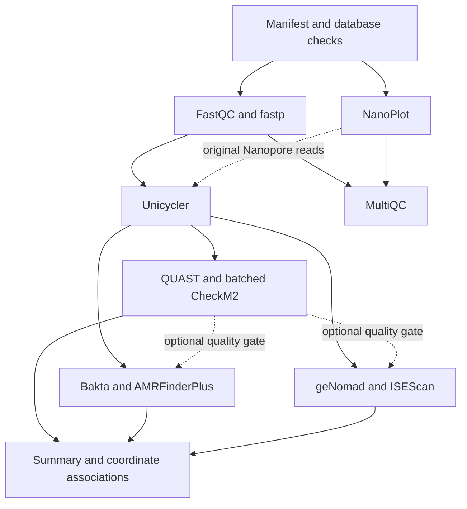

# BactGen Pipeline

## Overview

BactGen is a Snakemake 8.30.0 workflow for bacterial isolate genome assembly from
paired Illumina reads, optionally supplemented with Oxford Nanopore reads.
It implements read QC, Unicycler assembly, assembly QC, annotation, resistance
screening and mobile-element predictions with coordinate-aware association tables.

**Validation scope:** Python collectors, failure handling, configuration and manifest
checks, Snakefile parsing and dependency graphs are tested without biological tools.
Conda environment solving and real biological-tool execution have not been verified
in the authoring environment. Run the opt-in integration test before production use.
Pinned direct packages are provided; these are not fully solved platform lockfiles.

## Features

- Illumina-only and hybrid assembly selected independently for each sample.
- Isolated, version-pinned Conda environments and per-stage resources.
- One batched CheckM2 job for all assemblies; other analyses parallelize by sample.
- Optional functional modules and optional quality-based exclusion.
- Native results retained alongside normalized TSVs; explicit unavailable statuses.
- Atomic directory promotion after tool-specific validation, process logs and benchmarks.
- No database downloads during ordinary workflow execution.

## Pipeline Overview



FastQC runs on raw and cleaned Illumina mates; fastp always runs. NanoPlot is
report-only. The original Nanopore reads go to Unicycler without filtering.
AMRFinderPlus operates independently of Bakta, in documented nucleotide mode.
This mode does not perform the protein-HMM component of combined mode.

## Requirements

- Linux x86-64 is the intended deployment platform; Windows users should use WSL2.
- Conda/Mamba, Python 3.11+ for the workflow and Snakemake 8.30.0.
- Network access for the initial environment installation and separate database setup.
- Sufficient disk for input reads, assembly intermediates, annotation outputs and databases.
- Defaults request up to 32 GB RAM for a single assembly or CheckM2 job and up to
  64 GB in aggregate. Set resource values based on your data and hardware.

The isolated CheckM2/geNomad environments use Python 3.10; ISEScan uses Python 3.9
with older NumPy/SciPy/pandas/fastcluster pins. These do not change workflow Python.
Snakemake memory resources are scheduler reservations, not operating-system limits.

## Installation

From the extracted repository directory:

```bash
mamba env create -f environment.yaml
conda activate bactgen
snakemake --version
```

Use strict channel priority for predictable Conda solving:

```bash
conda config --set channel_priority strict
```

The isolated tool environments are created by `--use-conda` on first execution.
To explicitly prepare them after configuring inputs (may download substantial software):

```bash
snakemake --cores 1 --use-conda --conda-create-envs-only
```

This does not download the external biological databases. See
[resources/README.md](resources/README.md).

## Input Data

Populate `manifest.csv` (the shipped file contains only the required header).
`manifest.example.csv` shows paths for your own data; no biological reads are shipped.

```csv
sample,nanopore_reads,illumina_r1_reads,illumina_r2_reads
MSK-11,data/raw/MSK-11_nanopore.fastq.gz,data/raw/MSK-11_R1.fastq.gz,data/raw/MSK-11_R2.fastq.gz
MSK-13,,data/raw/MSK-13_R1.fastq.gz,data/raw/MSK-13_R2.fastq.gz
```

- Columns and order must match exactly. All cells are literal strings.
- Only the Nanopore cell may be empty. Do not write `NA`, `None`, `-` or whitespace.
- Extensions: `.fastq`, `.fq`, `.fastq.gz`, `.fq.gz` (ordinary gzip for compressed reads).
- Relative paths resolve against the manifest's directory; absolute read paths work too.
- Sample identifiers: 1–100 ASCII letters/digits/underscores/dots/hyphens, beginning
  with a letter or digit; case-insensitive uniqueness is enforced.
- Reusing the same read file across mates/samples, including symlink/hardlink aliases,
  is rejected. Both Illumina mates must exist and be nonempty. Nanopore-only is rejected.
- Validation does not scan entire FASTQs or infer pairing from filename patterns;
  supply correctly synchronized paired reads. fastp validates records during execution.

```bash
python workflow/scripts/validate_manifest.py manifest.csv
```

## Configuration

Edit `config.yaml`; all keys are validated, including unknown-key rejection.
Configuration paths other than read paths are relative to the repository working
directory. Run commands from this directory. `results_dir` must be a dedicated
relative subdirectory; `results` is the default. Logs and benchmarks remain under
`logs/` and `benchmarks/`.

| Configuration | Purpose |
|---|---|
| `manifest`, `results_dir` | Input manifest and output location |
| `modules.*` | Enable/disable CheckM2, Bakta, AMRFinderPlus, geNomad, ISEScan |
| `databases.*.path`, `.version` | Installed database path and exact release identifier |
| `fastp.*` | Quality threshold, minimum read length, paired adapter detection |
| `fastqc.enabled`, `nanoplot.enabled` | Report generation switches |
| `unicycler.mode` | `normal`, `conservative` or `bold` |
| `unicycler.min_fasta_length` | Minimum output contig length |
| `unicycler.extra_args` | Allowlisted alternating option/value string tokens |
| `quast.min_contig` | QUAST minimum contig size; assembly metrics use this threshold |
| `checkm2.*` | Completeness/contamination limits and `exclude_failed` |
| `bakta.*` | Genetic code, taxonomy, Gram type, minimum contig length |
| `amrfinder.plus`, `.organism` | Plus genes and optional supported taxonomic group |
| `genomad.splits`, `.cleanup` | Database search splitting and intermediate retention |
| `isescan.remove_short_is` | Pass the documented `--removeShortIS` switch |
| `coordinates.nearby_bp` | Maximum intervening bases for proximity |
| `resources.<stage>.threads`, `.mem_mb` | Per-job CPU and memory reservations |

Allowed Unicycler additional options are `--min_kmer_frac`, `--max_kmer_frac`,
`--kmer_count`, `--min_anchor_seg_len`, `--min_bridge_qual`, `--linear_seqs`,
`--depth_filter`. Example: `extra_args: ["--kmer_count", "8"]`.
Owned input/output/thread options cannot be overridden. Values must be separate
string tokens, never a shell command. The tool performs its own option-range checks.

```bash
python workflow/scripts/validate_config.py config.yaml
python workflow/scripts/validate_config.py config.yaml --check-databases
```

Database release fields initially say `SET_ME`; replace them with the actual installed
release. Structural validation/dry-runs do not require database files. Execution
preflight checks **all enabled database-backed modules**, even when requesting a read-QC
target; disable those modules if you intentionally want only read QC without databases.
No expensive jobs start until preflight succeeds.

## Database Setup

Follow [resources/README.md](resources/README.md). The required external databases
are CheckM2, Bakta, AMRFinderPlus and geNomad. ISEScan models are bundled with its
package. Install databases separately, keep release-specific directories immutable,
and record their release identifiers and archive checksums. No species is inferred
for Bakta or AMRFinderPlus; set taxonomy explicitly when appropriate.

## Running the Pipeline

```bash
# Validate local inputs and database configuration first.
python workflow/scripts/validate_manifest.py manifest.csv
python workflow/scripts/validate_config.py config.yaml --check-databases

# Preview every job; no tool execution or database downloads.
snakemake --cores 8 --dry-run

# Execute all stages; profile sets --use-conda and global memory.
snakemake --profile profiles/local

# Override the global budget.
snakemake --profile profiles/local --cores 32 --resources mem_mb=240000

# Named stage targets.
snakemake --profile profiles/local reads_qc_all
snakemake --profile profiles/local assembly_all
snakemake --profile profiles/local assembly_qc_all
snakemake --profile profiles/local annotation_all
snakemake --profile profiles/local summary_all

# A single assembly, including its read-filtering dependencies.
snakemake --profile profiles/local results/assembly/MSK-11/assembly.fasta

# Resume interrupted work.
snakemake --profile profiles/local --rerun-incomplete
```

For a database-free DAG check on the shipped synthetic parser fixtures:

```bash
snakemake --configfile tests/config.yaml --cores 2 --dry-run
snakemake --configfile tests/config.yaml --cores 2 --dag > dag.dot
```

Do not execute the full pipeline with the synthetic unit-test reads.
`all` includes MultiQC and all summary files; disabled modules are removed from
the graph and summary dependencies. Functional analyses do not wait for CheckM2
unless `exclude_failed: true`. A CheckM2 batch waits for all requested assemblies.

## Output Structure

Paths below assume the default `results_dir`:

| Path | Contents |
|---|---|
| `results/provenance/` | Resolved manifest, effective config, environment-spec hashes |
| `results/qc/fastp/{sample}/` | Cleaned `R1.fastq.gz`, `R2.fastq.gz`, JSON and HTML |
| `results/qc/fastqc/{sample}/{raw,clean}_{R1,R2}/` | FastQC ZIP and HTML |
| `results/qc/nanoplot/{sample}/` | Native NanoPlot outputs |
| `results/qc/multiqc/` | MultiQC report and data; directory-prefixed names prevent collisions |
| `results/assembly/{sample}/assembly.fasta` | Validated final nucleotide assembly |
| `results/assembly/{sample}/` | Native Unicycler outputs, optional GFA, execution metadata |
| `results/quast/{sample}/` | Native QUAST reports including all available metrics |
| `results/checkm2/quality_report.tsv` | Original batched CheckM2 report |
| `results/bakta/{sample}/annotation.*` | GFF3, GBFF, FAA, FFN, TSV, JSON and native outputs |
| `results/amrfinder/{sample}/amrfinder.tsv` | Full native AMRFinderPlus result |
| `results/genomad/{sample}/` | All native geNomad outputs |
| `results/isescan/{sample}/` | Native predictions, families, sequences, HMMER searches |
| `results/summary/` | Nine normalized/summary TSVs listed below |
| `logs/{stage}/`, `benchmarks/{stage}/` | Commands, stdout/stderr, timings and measured resources |

Summary files are `assembly_summary.tsv`, `annotation_summary.tsv`,
`resistance_summary.tsv`, `mobile_elements_summary.tsv`, `samples_summary.tsv`,
`resistance_genes.tsv`, `mobile_elements.tsv`, `arg_mobile_associations.tsv`,
`checkm2_normalized.tsv`. All include headers, including legitimately empty hit tables.
The main table contains the required assembly, quality, annotation, ARG and mobile
counts plus explicit status columns. `checkm2_normalized.tsv` retains the additional
native CheckM2 columns with their original names. Native full AMR/geNomad/ISEScan
reports retain additional fields not copied to the compact normalized tables.

### Counting and coordinate conventions

- Genome size, contig count, N50, L50, GC and largest contig are taken from the
  single-assembly QUAST report, after `quast.min_contig` filtering. GC is percent.
- Completeness and contamination are CheckM2 percentages. Other metrics/model
  identifiers remain in its native and normalized tables.
- CDS/tRNA/rRNA count exact corresponding GFF3 feature types from Bakta. CDS counts
  follow Bakta's GFF3 representation, including pseudogene CDS if emitted as CDS.
- `ARG_count` counts AMRFinder rows with type **AMR** and subtype **AMR** (gene hits,
  not unique gene symbols). POINT mutations and all Plus hits are counted separately.
  Counts are predictions and do not establish phenotypic resistance.
- `plasmid_sequences` and `viral_sequences` count respective geNomad summary rows,
  including provirus regions. A plasmid-classified contig is not necessarily a complete
  plasmid, and multiple fragments can originate from the same replicon.
- `IS_elements_count` counts ISEScan native prediction rows, including partial copies
  unless `remove_short_is` excludes them. Missing output is accepted as zero only if
  both HMMER tables contain their completion footers and ISEScan explicitly reports
  no IS elements. Otherwise the job fails.
- `success` with zero rows means zero detected hits. `disabled`, `missing` and
  `skipped_quality` produce `NA` counts, never invented zeros. Tool errors stop their
  jobs and dependent summaries; use the standalone collector for partial-result audits.
- Contig identifiers use the exact FASTA first token. Bakta preserves original headers;
  AMRFinderPlus, geNomad and ISEScan all use the same unmodified assembly FASTA.
- All normalized coordinates are **1-based inclusive**. AMRFinder reversed endpoints
  are sorted; the original strand is retained. geNomad's documented terminal
  `|provirus_start_end` suffix is removed only to recover the parent contig, with
  coordinate consistency checks. Whole-contig classifications span `1..contig_length`.
- Associations are reported for ARG gene hits. `same_contig` tests identifier equality;
  `overlap` tests interval intersection; `nearby` tests the number of bases strictly
  between intervals against `coordinates.nearby_bp`. Adjacent intervals have gap zero.
  More distant hits retain `same_contig`. Invalid/missing coordinates receive explicit
  unavailable/incompatible statuses. No circular wrap-around distance is inferred.
- `proven_membership` is always `not_established`: proximity, overlap with a prediction,
  or a shared contig does not by itself prove ARG carriage by a mobile element.

The standalone partial-result collector is:

```bash
python workflow/scripts/generate_summary.py --config config.yaml
```

It flags missing analyses, while malformed native reports raise errors. It still
requires a valid manifest and existing raw files, and overwrites the summary tables.

## Quality Control

Default limits are completeness >=90% and contamination <=5%. These are configurable
screening thresholds, not universal acceptance criteria. Low-quality assemblies are
flagged but still annotated by default. With `checkm2.exclude_failed: true`, failed
samples receive only `status.json` containing `skipped_quality` for functional stages;
no fake biological result files are created. QUAST/CheckM2 still run and remain reported.
Exclusion requires CheckM2 enabled.

Hybrid assembly depends on read depth, DNA quality, repeat structure, long-read error
profiles and library consistency. Neither hybrid assembly nor a circular graph alone
establishes the correct replicon structure. Review graphs, read support and taxonomic
consistency before interpreting resistance/mobile-element context. The pipeline does
not perform host depletion, strain deconvolution, taxonomic assignment or read mapping.

## Reproducibility

Direct versions are pinned in `workflow/envs/`; Snakemake is pinned in the controller
environment. Dependency builds remain solver-dependent until you export explicit
platform locks. Each successful job's `status.json` records commands, elapsed time
and installed Conda package versions/builds. Preflight saves the effective configuration,
manifest, resolved read paths and environment-spec hashes. Snakemake benchmarks retain
runtime/resource measurements. Assembly files must be nonempty valid nucleotide FASTA
before promotion; directory existence alone never establishes first-run success.

Use release-specific immutable database paths and record checksums externally. Do not
update a database in place. Change its configuration path/version when upgrading.
Snakemake reruns affected jobs on input/parameter/code changes; successful jobs are
reused on unchanged runs. Shared Python/environment changes invalidate preflight and
its descendants conservatively. Preserve the original working directory for metadata
reuse. Treat generated output directories as immutable: Snakemake tracks directory
completion timestamps, not manual deletion of their contents. If editing/corruption
occurs, remove the affected directory or force its producing rule, then rerun.
Native intermediate files in completed directories are retained, not marked temporary.

## Troubleshooting

- **Empty manifest/missing FASTQ:** populate the manifest and run its validator. Do not
  execute the example manifest until its files exist.
- **Database SET_ME or missing path:** finish separate database setup and record exact
  release identifiers. Confirm tool/database compatibility with a small real-data run.
- **Conda solving fails:** use strict priority on Linux x86-64. Resolve the individual
  YAML with `mamba env create -f workflow/envs/isescan.yaml -n isescan-test` to diagnose
  that environment. Do not install old ISEScan dependencies into the controller.
- **ISEScan returns exit zero but outputs are absent:** the wrapper requires complete
  HMMER files and explicit no-hit evidence; inspect the log and native dependency install.
- **Out of memory:** increase the corresponding reservation and global budget, reduce
  concurrent jobs and/or raise `genomad.splits`. Reservations do not constrain tools.
- **Missing native report despite success status:** treat as corruption; remove/force
  that module's output and rerun. The collector does not silently replace it with zero.
- **Large log/output directories:** Unicycler and geNomad retain intermediates. Use
  geNomad cleanup explicitly if desired; retain native summaries and execution records.

## Testing

```bash
python -m pip install -r requirements-dev.txt
ruff check workflow/scripts tests
python -m compileall -q workflow/scripts tests
pytest -q -m 'not integration'
```

CI runs the light suite on Python 3.11 and 3.12, without biological databases. Fixtures
are synthetic and explicitly labeled in `tests/data/README.md`. Tests cover manifests,
config validation, parsers, coordinate boundaries, missing-versus-zero semantics,
subprocess failures, all named DAG targets and module switches. A minimal real Snakemake
script job exercises preflight dispatch and unchanged-run reuse without external tools.

Opt-in integration: supply real small reads and compatible installed databases in an
independent YAML config, using a fresh `results_dir`:

```bash
BACTGEN_INTEGRATION_CONFIG=/absolute/path/to/integration.yaml \
BACTGEN_CORES=4 pytest -v -m integration
```

For an explicitly downloaded small Unicycler example (about 7.7 MB compressed reads,
not a full bacterial genome), see [tests/INTEGRATION.md](tests/INTEGRATION.md).
This test runs actual software and checks that a second run requires no work. It is
not enabled automatically in GitHub Actions.

## Citation

Cite the individual tools and database releases used in your analysis. Official
software references/documentation:
[FastQC](https://www.bioinformatics.babraham.ac.uk/projects/fastqc/),
[fastp](https://github.com/OpenGene/fastp),
[NanoPlot](https://github.com/wdecoster/NanoPlot),
[MultiQC](https://docs.seqera.io/multiqc),
[Unicycler](https://github.com/rrwick/Unicycler/tree/v0.5.1),
[QUAST](https://quast.sourceforge.net/docs/manual.html),
[CheckM2](https://github.com/chklovski/CheckM2/tree/1.1.0),
[Bakta](https://github.com/oschwengers/bakta/tree/v1.10.4),
[AMRFinderPlus](https://github.com/ncbi/amr/wiki/Running-AMRFinderPlus),
[geNomad](https://portal.nersc.gov/genomad/quickstart.html),
[ISEScan](https://github.com/xiezhq/ISEScan/tree/v1.7.3),
[Snakemake](https://snakemake.readthedocs.io/en/v8.30.0/).
See [docs/INTERFACES.md](docs/INTERFACES.md) for native output contracts and source references.
No DOI is claimed for this repository.

## License

Pipeline source is MIT licensed; see [LICENSE](LICENSE). Third-party software,
databases and downloaded example data retain their respective licenses.
