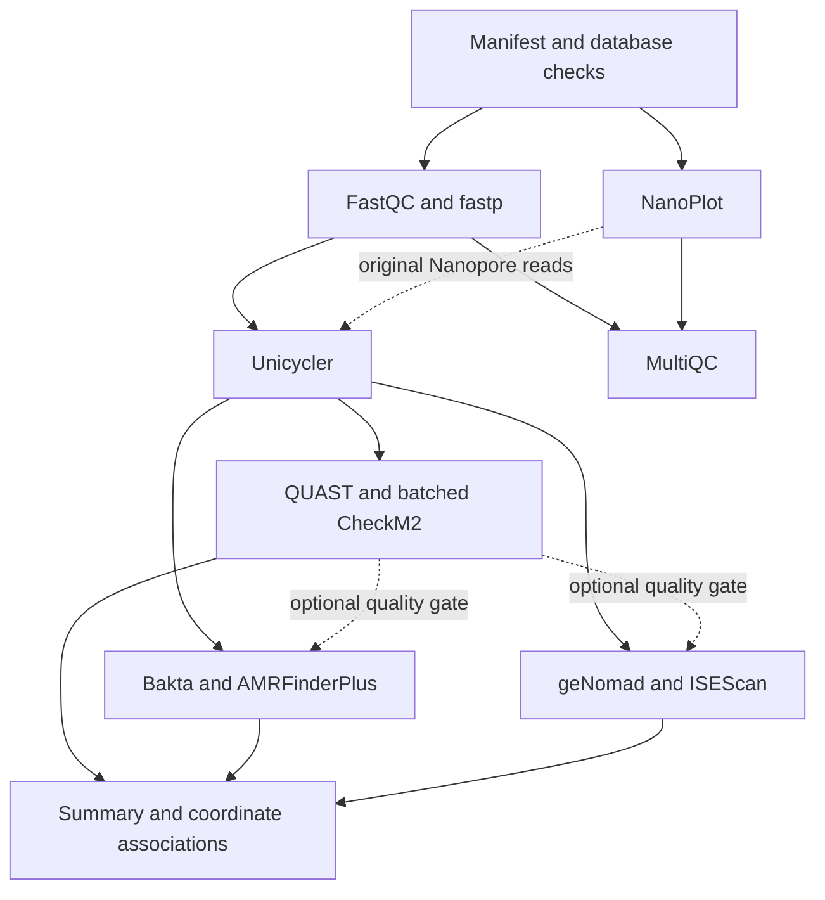

# BactGen Pipeline

## Overview

BactGen is a Snakemake 8.30.0 workflow for bacterial isolate genome assembly from
paired Illumina reads, optionally supplemented with Oxford Nanopore reads.
It implements read QC, Unicycler assembly, assembly QC, annotation, resistance
screening and mobile-element predictions with coordinate-aware association tables.

## Pipeline Overview



## Requirements

- Linux x86-64 is the intended deployment platform; Windows users should use WSL2.
- Conda/Mamba, Python 3.11+ for the workflow and Snakemake 8.30.0.
- Defaults request up to 32 GB RAM for a single assembly or CheckM2 job and up to
  64 GB in aggregate. Set resource values based on your data and hardware.

## Installation

From the extracted repository directory:

```bash
mamba env create -f environment.yaml
conda activate bactgen
snakemake --version
```

Use strict channel priority for predictable Conda solving:

```bash
conda config --set channel_priority strict
```

The isolated tool environments are created by `--use-conda` on first execution.
To explicitly prepare them after configuring inputs (may download substantial software):

```bash
snakemake --cores 1 --use-conda --conda-create-envs-only
```

## Input Data

Populate `manifest.csv`.

```csv
sample,nanopore_reads,illumina_r1_reads,illumina_r2_reads
```

## Configuration

Edit `config.yaml`.

| Configuration | Purpose |
|---|---|
| `manifest`, `results_dir` | Input manifest and output location |
| `modules.*` | Enable/disable CheckM2, Bakta, AMRFinderPlus, geNomad, ISEScan |
| `databases.*.path`, `.version` | Installed database path and exact release identifier |
| `fastp.*` | Quality threshold, minimum read length, paired adapter detection |
| `fastqc.enabled`, `nanoplot.enabled` | Report generation switches |
| `unicycler.mode` | `normal`, `conservative` or `bold` |
| `unicycler.min_fasta_length` | Minimum output contig length |
| `unicycler.extra_args` | Allowlisted alternating option/value string tokens |
| `quast.min_contig` | QUAST minimum contig size; assembly metrics use this threshold |
| `checkm2.*` | Completeness/contamination limits and `exclude_failed` |
| `bakta.*` | Genetic code, taxonomy, Gram type, minimum contig length |
| `amrfinder.plus`, `.organism` | Plus genes and optional supported taxonomic group |
| `genomad.splits`, `.cleanup` | Database search splitting and intermediate retention |
| `isescan.remove_short_is` | Pass the documented `--removeShortIS` switch |
| `coordinates.nearby_bp` | Maximum intervening bases for proximity |
| `resources.<stage>.threads`, `.mem_mb` | Per-job CPU and memory reservations |

Allowed Unicycler additional options are `--min_kmer_frac`, `--max_kmer_frac`,
`--kmer_count`, `--min_anchor_seg_len`, `--min_bridge_qual`, `--linear_seqs`,
`--depth_filter`. Example: `extra_args: ["--kmer_count", "8"]`.
Owned input/output/thread options cannot be overridden. Values must be separate
string tokens, never a shell command. The tool performs its own option-range checks.

```bash
python workflow/scripts/validate_config.py config.yaml
python workflow/scripts/validate_config.py config.yaml --check-databases
```

## Database Setup

Follow [resources/README.md](resources/README.md). The required external databases
are CheckM2, Bakta, AMRFinderPlus and geNomad. ISEScan models are bundled with its
package. 

## Running the Pipeline

```bash
# Validate local inputs and database configuration first.
python workflow/scripts/validate_manifest.py manifest.csv
python workflow/scripts/validate_config.py config.yaml --check-databases

# Preview every job; no tool execution or database downloads.
snakemake --cores 8 --dry-run

# Execute all stages; profile sets --use-conda and global memory.
snakemake --profile profiles/local

# Override the global budget.
snakemake --profile profiles/local --cores 32 --resources mem_mb=240000

# Named stage targets.
snakemake --profile profiles/local reads_qc_all
snakemake --profile profiles/local assembly_all
snakemake --profile profiles/local assembly_qc_all
snakemake --profile profiles/local annotation_all
snakemake --profile profiles/local summary_all

# A single assembly, including its read-filtering dependencies.
snakemake --profile profiles/local results/assembly/MSK-11/assembly.fasta

# Resume interrupted work.
snakemake --profile profiles/local --rerun-incomplete
```

## Output Structure

Paths below assume the default `results_dir`:

| Path | Contents |
|---|---|
| `results/provenance/` | Resolved manifest, effective config, environment-spec hashes |
| `results/qc/fastp/{sample}/` | Cleaned `R1.fastq.gz`, `R2.fastq.gz`, JSON and HTML |
| `results/qc/fastqc/{sample}/{raw,clean}_{R1,R2}/` | FastQC ZIP and HTML |
| `results/qc/nanoplot/{sample}/` | Native NanoPlot outputs |
| `results/qc/multiqc/` | MultiQC report and data; directory-prefixed names prevent collisions |
| `results/assembly/{sample}/assembly.fasta` | Validated final nucleotide assembly |
| `results/assembly/{sample}/` | Native Unicycler outputs, optional GFA, execution metadata |
| `results/quast/{sample}/` | Native QUAST reports including all available metrics |
| `results/checkm2/quality_report.tsv` | Original batched CheckM2 report |
| `results/bakta/{sample}/annotation.*` | GFF3, GBFF, FAA, FFN, TSV, JSON and native outputs |
| `results/amrfinder/{sample}/amrfinder.tsv` | Full native AMRFinderPlus result |
| `results/genomad/{sample}/` | All native geNomad outputs |
| `results/isescan/{sample}/` | Native predictions, families, sequences, HMMER searches |
| `results/summary/` | Nine normalized/summary TSVs listed below |
| `logs/{stage}/`, `benchmarks/{stage}/` | Commands, stdout/stderr, timings and measured resources |

Summary files are `assembly_summary.tsv`, `annotation_summary.tsv`,
`resistance_summary.tsv`, `mobile_elements_summary.tsv`, `samples_summary.tsv`,
`resistance_genes.tsv`, `mobile_elements.tsv`, `arg_mobile_associations.tsv`,
`checkm2_normalized.tsv`. All include headers, including legitimately empty hit tables.
The main table contains the required assembly, quality, annotation, ARG and mobile
counts plus explicit status columns. `checkm2_normalized.tsv` retains the additional
native CheckM2 columns with their original names. Native full AMR/geNomad/ISEScan
reports retain additional fields not copied to the compact normalized tables.

## Citation

Official
software references/documentation:
[FastQC](https://www.bioinformatics.babraham.ac.uk/projects/fastqc/),
[fastp](https://github.com/OpenGene/fastp),
[NanoPlot](https://github.com/wdecoster/NanoPlot),
[MultiQC](https://docs.seqera.io/multiqc),
[Unicycler](https://github.com/rrwick/Unicycler/tree/v0.5.1),
[QUAST](https://quast.sourceforge.net/docs/manual.html),
[CheckM2](https://github.com/chklovski/CheckM2/tree/1.1.0),
[Bakta](https://github.com/oschwengers/bakta/tree/v1.10.4),
[AMRFinderPlus](https://github.com/ncbi/amr/wiki/Running-AMRFinderPlus),
[geNomad](https://portal.nersc.gov/genomad/quickstart.html),
[ISEScan](https://github.com/xiezhq/ISEScan/tree/v1.7.3),
[Snakemake](https://snakemake.readthedocs.io/en/v8.30.0/).

## License

Pipeline source is MIT licensed; see [LICENSE](LICENSE). Third-party software,
databases and downloaded example data retain their respective licenses.
